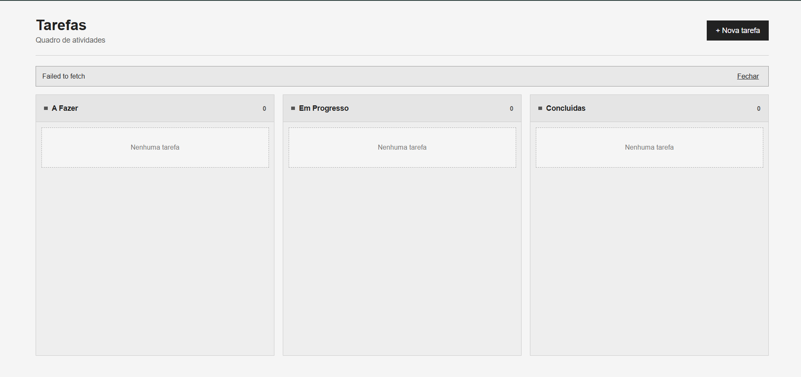
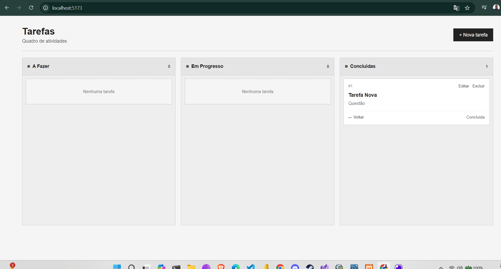

# Mini Kanban de Tarefas

Aplicação full-stack criada para o desafio técnico da Veritas Consultoria Empresarial. O projeto permite organizar tarefas em três etapas, com uma interface React e uma API REST em Go.

## Funcionalidades

- Criar tarefas com título obrigatório e descrição opcional.
- Editar e excluir tarefas.
- Mover tarefas entre as colunas A Fazer, Em Progresso e Concluídas.
- Exibir feedback de carregamento e erros na interface.
- Validar título e status recebidos pela API.

## Tecnologias

**Frontend:** React, TypeScript, Vite, CSS e Fetch API  
**Backend:** Go, net/http e armazenamento em memória

## Estrutura

~~~text
desafio-fullstack-veritas/
├── backend/
│   ├── main.go
│   ├── handlers.go
│   └── models.go
├── frontend/
│   ├── package.json
│   └── src/
├── docs/
│   ├── user-flow.png
│   ├── kanban-1.png
│   └── kanban-2.png
└── README.md
~~~

## Executar localmente

Você precisa de Go, Node.js e npm instalados.

### 1. Iniciar a API

Em um terminal, na raiz do repositório:

~~~bash
cd backend
go run .
~~~

A API fica disponível em http://localhost:8080.

### 2. Iniciar o frontend

Em outro terminal, na raiz do repositório:

~~~bash
cd frontend
npm install
npm run dev
~~~

Abra o endereço local exibido pelo Vite (normalmente http://localhost:5173).

## API

| Método | Rota | Descrição |
|---|---|---|
| GET | /tasks | Lista as tarefas |
| POST | /tasks | Cria uma tarefa |
| PUT | /tasks/{id} | Atualiza uma tarefa |
| DELETE | /tasks/{id} | Exclui uma tarefa |

Os status aceitos são todo, in_progress e done. O corpo de uma tarefa usa os campos id, title, description e status; o id é atribuído pela API na criação.

## Decisões e limitações

- O backend usa o pacote padrão net/http, sem framework externo.
- As tarefas ficam em memória e são perdidas quando o servidor é encerrado.
- O projeto não tem banco de dados nem autenticação.
- Esta é uma implementação de desafio/estudo; não é apresentada como serviço de produção.

## Fluxo e telas

Fluxo de uso: [docs/user-flow.png](docs/user-flow.png)

